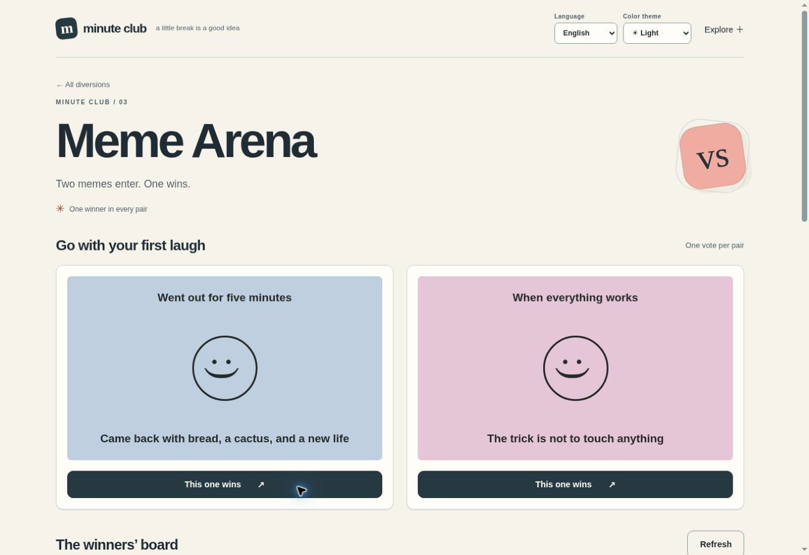

<div align="center">


# Meme Arena

**Two memes. One winner.**

Pick the funnier card in head-to-head battles and discover the winners.

**English** · [Русский](README.ru.md)

  

</div>

[Features](#features) · [Stack](#technology-stack) · [Quick start](#quick-start) · [License](LICENSE)



*Actual application capture with example data. Visible counts are demonstration interactions, not audience statistics.*

## Features

- Head-to-head meme voting
- Winners board
- Image submissions with approval before publication

**Try the flow: Pick a card → next duel → explore winners.**

Documentation: English / Русский. App interface: English, Русский, selected from browser preferences or manually. System theme by default, with explicit light and dark modes. The system mode follows device changes; your choice is saved locally.

## Technology stack

| Layer | Implementation |
| --- | --- |
| Interface | HTML · CSS · JavaScript / native ES modules |
| Runtime | Node.js 24+ · SQLite |
| Development | TypeScript for preferences and server validation; the rest is JavaScript |
| Dependencies | No third-party browser libraries or remote fonts |

## Quick start

Requires Node.js 24+. No install or build step.

```sh
npm start
```

Open http://localhost:3000. The root opens this application; unrelated app routes and APIs are disabled. Data persists in `data/minute.sqlite`.

```sh
npm test
npm run check
```

## Enable image submissions

Set `ADMIN_TOKEN` to a long random secret before starting. Without a key, uploads are disabled. Review submissions at `/admin/`. Images remain private until approved. The browser compresses JPEG/PNG/WebP to 500 KB; the server validates size, signature, and dimensions. Animated files are not supported in v1. This project defaults to **40 GB** of accepted media.

## Deploy

Set `PUBLIC_ORIGIN` to the exact HTTPS origin, give the process a persistent `DATA_DIR`, and put an HTTPS reverse proxy in front. Example Dockerfile, Caddy config, environment file, and systemd unit are included. Each independent project needs its own port and data directory. `.env` is not loaded automatically: use exported variables or `node --env-file=.env server/index.mjs`. See [OPERATIONS.md](OPERATIONS.md) for backups, moderation, identity limitations, and storage details.


## Develop with TypeScript

Generated JavaScript is committed, so production needs no TypeScript compiler. Development uses pinned tools:

```sh
npm ci
npm run typecheck
npm run build
npm run check:generated
npm test
npm run check
```

`src/preferences*.ts` is the source for language negotiation and the early theme bootstrap. Server projects also compile `src/validation.mts` into `server/validation.mjs`. `src/contracts.ts` describes shared data shapes. The compiler uses strict mode, checked indexed access, and exact optional properties; errors block emission. Edit these TypeScript sources, then rebuild. Other existing application modules are still JavaScript: this is an incremental migration, not a claim of complete TypeScript coverage.

The build emits ordinary ES2022 JavaScript, then compiles the two locale variants. No compiler or framework is shipped to visitors. CI checks types, generated output, behavior, and the asset budget.

---

[More by den9911](https://github.com/den9911) · [Report an issue](https://github.com/den9911/meme-arena/issues) · [LICENSE](LICENSE)
